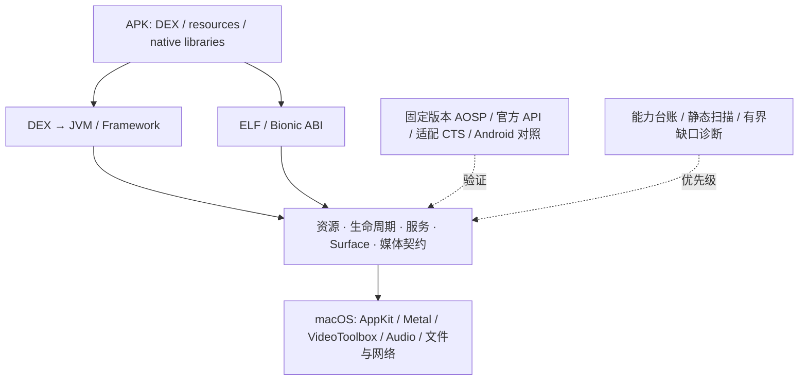

# Mac.apk 升级路线图

更新：2026-11-19。初始决策基点：`7cb38df7bfcced3412901af262f4d109f6b4f9fc`（对应 `fork/main` `7f73c07`）；当前最新基线见 [PROJECT_STATE.md](../PROJECT_STATE.md) 与 [UPGRADE_PLAN.md](UPGRADE_PLAN.md)。

目标：在明确的 Android 契约范围内扩大兼容性，减少启动、绘制、调度、内存与功耗开销，
并让后续 AI 能按有证据的任务连续推进。**实际唯一任务顺序与实时状态以 [UPGRADE_PLAN.md](UPGRADE_PLAN.md) 为准。**

## 1. 架构选择

保留现有原生兼容架构，采用“Android 契约驱动 + 选择性复用 AOSP + macOS 原生后端”。
理由、替代方案及重新评估条件见 [ADR-0001](adr/0001-contract-driven-runtime.md)，
各 AI 建议的正确、错误与条件采纳项见 [核查表](AI_PROPOSALS_REVIEW_2026-11-14.md)。

不选择完整 AOSP 移植、整层 android-all 替换或运行中切 VM；不生成按返回类型猜值的通用 stub。
不按应用包名、业务类名或资源 ID 添加生产分支，也不将此类分支挪入配置表规避约定。
不预先决定 JVM/ANGLE/Skia 版本升级。既有合理的通用实现优先保留。

## 2. 基准、声明与证据分开

1. **源码对照版本**：第一轮采用现有资源配方的 Android 16 / API 36、`android-16.0.0_r2`。
   这是新契约条目默认研究锚点，不是“本运行时完整支持 API 36”的声明。
2. **实际对外版本**：保留 `PresentedSdk` 的现有规则；记录 override、target SDK 和最终 presented SDK。
   当前默认路径随 target SDK 夹到 29–36，解析失败或关闭时回到 29。不能只读取 Build.java 的旧注释。
3. **行为变化**：旧 target SDK、API 30 参考镜像和 API 36 新语义分别列例。
   对照环境不匹配时必须说明差异，不能用 API 30 的结果判 API 36 资源/行为全部错误。
4. **验证范围**：方法签名、符号导出、行为用例、APK 场景是四类覆盖数据，各有分母。
   “代码存在”“有正确返回”“在某版本已验证”不可合并成一个绿色标记。
5. **硬件/GMS 等能力**：按 API 契约申报不存在、受限或失败；不默认声明全部传感器/codec 可用。
   无硬件证明/DRM 支持时如实记录，不伪造完整性、设备身份或支付结果。

CAP-001 固化以上字段。需要改变默认 SDK 策略时必须另有版本矩阵、契约依据和 ADR，
不能在建立台账时顺手改声明。

## 3. 分阶段交付

准确顺序与状态只在 [UPGRADE_PLAN.md](UPGRADE_PLAN.md) 维护。每次一张卡，完成后可连续下一张。
不按月份承诺性能；阶段出口决定是否继续。

| 阶段 | 核心任务 | 阶段出口 |
|---|---|---|
| P0 可复现基础（DONE） | BASE-002 → TEST-001；SEC-001、COMP-001 | 已完成并冻结 |
| P1 扫描与实跑（DONE） | CAP-001 → SCAN-001 → GAPLOG-001 | 已完成并冻结（18 项去重缺口） |
| P2 首项与批量契约修复（DONE） | CONTRACT-001 → ARCH-001 → PILOT-001 | 首批 `runtime/java/` 公共 API 契约修复落地，14/14 契约 `PASS` |
| P3 专项基建（DONE） | CI-001、GATE-001、PERF-001 → OBS-001、AOSP-EVAL-001 | 已完成并冻结；不再增加前置文档/工具卡 |
| P4 代码修复冲刺（DONE） | `MEDIA-001 → GATE-002 → IPC-001 → SURFACE-001 → SCHED-001 → GPU-001 / CACHE-001 → SURFACE-002/003 → RES-001 → GC-001 → HOTAPI-001/002/003` + 上游 fork 整合 + `GAP-IPC-003`/`GAP-MED-002` | 全部离线实现、台账与核心回归已落地 |
| P5 实机验收与性能闭环（当前阶段） | 交互式 Sidecar/B 站 9.19.0 验收（`VIDEO-PWR-001` / `GFX-001` / `DANMAKU-001`）+ 排查 `RemoteServiceProcessTest` 失败 + `CI-002`（需远端授权） | 实机播放/旋转/弹幕/功耗闭环，见 [UPGRADE_PLAN.md](UPGRADE_PLAN.md) |

P0–P4 基建、契约修复、Surface/调度/缓存重构与高频 Stub（含 `HOTAPI-003`）已收口。当前实时状态表见 [UPGRADE_PLAN.md](UPGRADE_PLAN.md)。

## 4. 代码修复冲刺队列历史与当前下一批

`ARCH-001` 锁定的首轮队列（`PILOT-001` 至 `GC-001`）与 `HOTAPI-001..003` 均已完成（状态见 [UPGRADE_PLAN.md](UPGRADE_PLAN.md)）：

| 阶段 / 批次 | 内容与范围 | 当前状态 |
|---|---|---|
| 1–7 + 备选（首轮代码修复） | `PILOT-001`、`MEDIA-001`、`GATE-002`、`IPC-001`、`SURFACE-001`、`SCHED-001`、`GPU-001`、`CACHE-001`、`SURFACE-002/003`、`RES-001`、`GC-001` | 全部 `DONE` |
| 上游 fork + 高频 Stub + 残余离线缺口 | `FORK-MERGE-2026-11-14`、`HOTAPI-001..003`、`GAP-IPC-003`、`GAP-MED-002` | 全部 `DONE` |
| 专项实测优化与 Sidecar 验收（当前核心） | `VIDEO-PWR-001`（Slice A/B、Binder FIFO、`OutputTarget`、Sidecar 自动化，余 `ijk_ff_vout` 107 ms 与 `RemoteServiceProcessTest` 待修）、`GFX-001`、`DANMAKU-001` | `IN_PROGRESS` / `PENDING`（实时进展见 [PROJECT_STATE.md](../PROJECT_STATE.md)） |

## 5. 兼容性验证梯度

| 层级 | 用途 | 不能替代什么 |
|---|---|---|
| 签名/ABI 检查 | 明确可解析符号及继承/重载/ABI 的差集 | 不能证明函数行为正确或 app 一定启动 |
| 主机契约测试 | 返回值、异常、序列化、顺序与生命周期的快速回归 | 不能冒充 JNI、真实多进程、GPU 或安装态 |
| Android 对照 | 同用例、对应 API/target SDK、明确硬件特性 | 不能用不匹配版本 golden 证明未来 API；不能把 Robolectric 当唯一 oracle |
| 最小 APK/runtime fixture | DEX→加载→Framework→native 的真实链路 | 不能代表商业应用所有内容、登录和服务器路径 |
| 跨类型应用场景 | 发现组合问题和用户可见回归 | 单次“能启动”不能标整个模块 verified |

CONTRACT-001 先完成离线、有 AOSP 来源的测试和差异记录；[ORACLE-001](tasks/ORACLE-001.md)
单独处理真实 Android 对照。没有对应环境时记录 NOT_RUN，优先继续无该依赖的任务。
涉及时间顺序/版本歧义的变更不能靠未知 oracle 假设改为默认；在任务里保留明确门禁。
测试模拟器不属于产品 VM fallback，二者不可混淆。

## 6. 性能与稳定性决策

- 测量先固定源码/实际 runtime/JAR、APK hash 与采样区间；优先复用 `PERF-001` 与 `OBS-001` 已建立的轻量脚本与计数器。
- 取消改动前强制 30 分钟长跑 soak、取消改动前强制多进程 Sidecar ABBA 矩阵；先落地小范围可逆优化并用前后同条件对比验证，跨屏/GUI 复核在连接显示器或副屏后按需执行（未连接如实标 `NOT_RUN`）。
- 缓存必须有容量与失效规则；零拷贝必须明确 pixel owner、同步与生命周期。

细则复用 [PERFORMANCE.md](../PERFORMANCE.md)。

## 7. 既有工作与旧文档

- FND-001、BASE-001 的 DONE 保留为历史完成；BASE-002 刷新当前 HEAD，不抹去既有证据。
- [GFX-001](tasks/GFX-001.md)、[DANMAKU-001](tasks/DANMAKU-001.md)、[VIDEO-PWR-001](tasks/VIDEO-PWR-001.md)
  保留原状态和用户验收要求。它们是 P4 的场景/证据来源；涉及其路径时必须复测，不能无条件跳过。
- 播放器竖/横全屏、弹幕 off/on/再开、resize、返回、自动切集以及切换后至少 30 秒音画连续性，
  是历史未关闭项。HUD 帧率、离线 Java 测试或旧截图不能替代。
- [旧手册](MACAPK_UPGRADE_HANDBOOK.md) 用于架构地图与历史根因；涉及当前功能缺失、默认值和分支时以源码复核。
- 当前基点已有多进程、epoll/kqueue、procfs、部分 IOSurface 和 Skia Metal、BitmapShader 缓存、JDK AOT gate；
  应先验证、补齐及收敛，不作为全新工程重写。

## 8. 连续执行与交付

按 [执行协议](AUTONOMOUS_EXECUTION.md) 选择任务、建立检查点、验收并继续。
用户无需逐卡接手技术决策；无法取得设备/账号/发布授权的部分留下精确解除条件，继续独立工作。
远端发布、第三方重大升级、产品边界变化仍遵守已有授权和项目规则。
文档不会自行启动后台任务；下一次要求“继续升级”时，AI 从任务表的下一张可执行卡继续。

完成每张卡交付：结果、文件、真实命令/退出码/证据、未覆盖项、风险、回退、下一卡。
检查点只保存本任务文件，禁止顺便提交用户文件或 APK。项目旧的“供用户测试新版本即安装”授权见
PROJECT_STATE.md，按其适用范围执行，不把本轮规划或内部构建自动当作发给用户的新版本。
